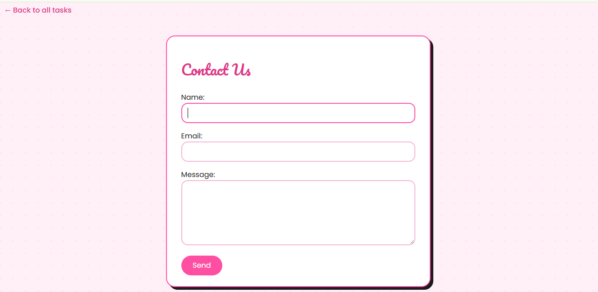
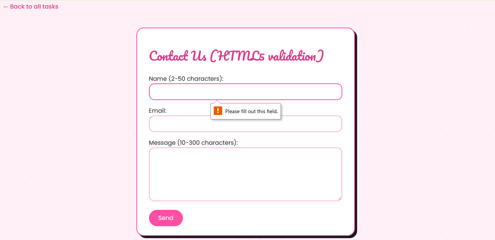
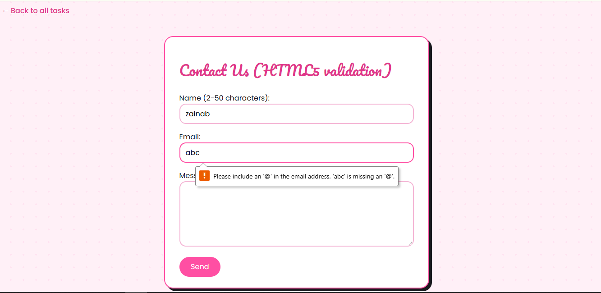
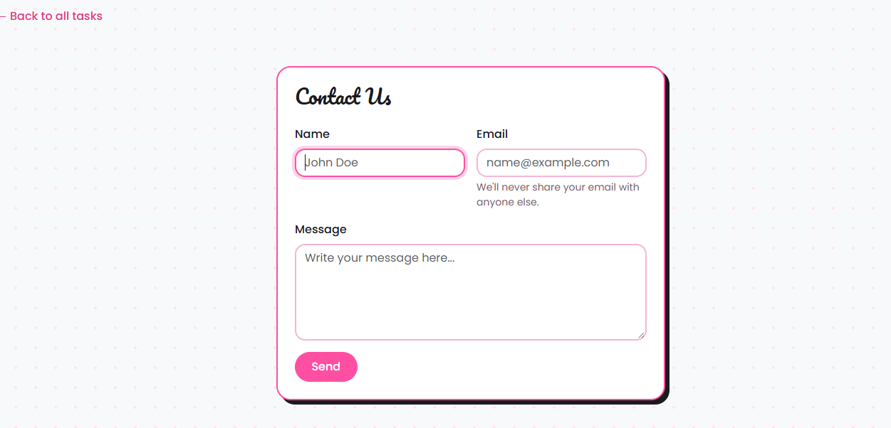
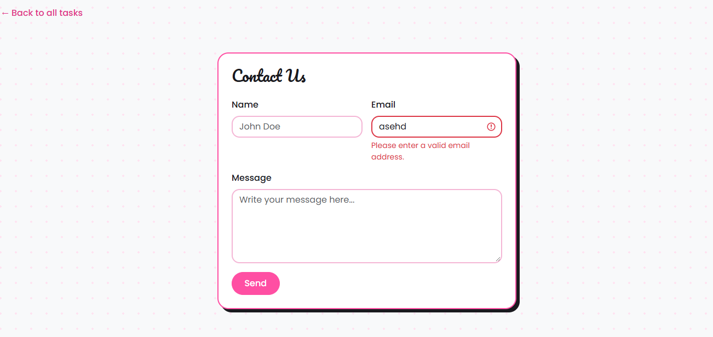
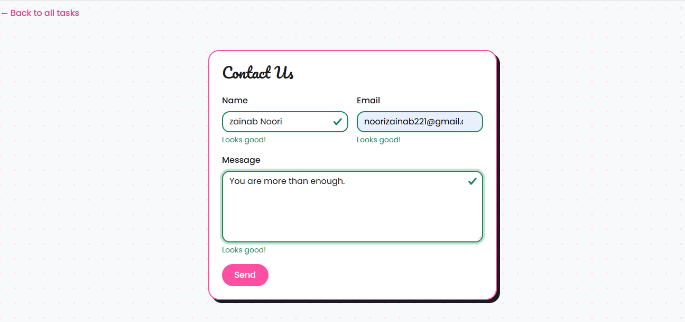
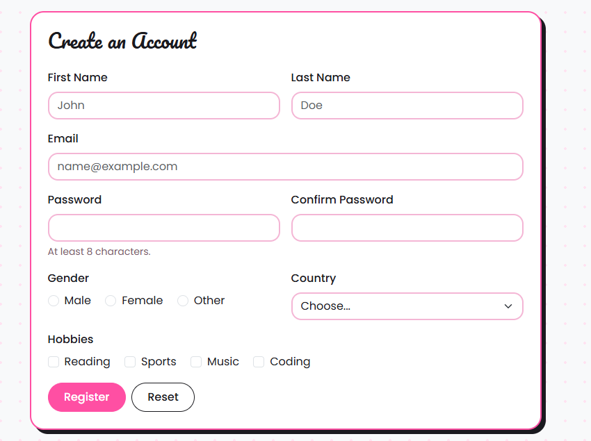
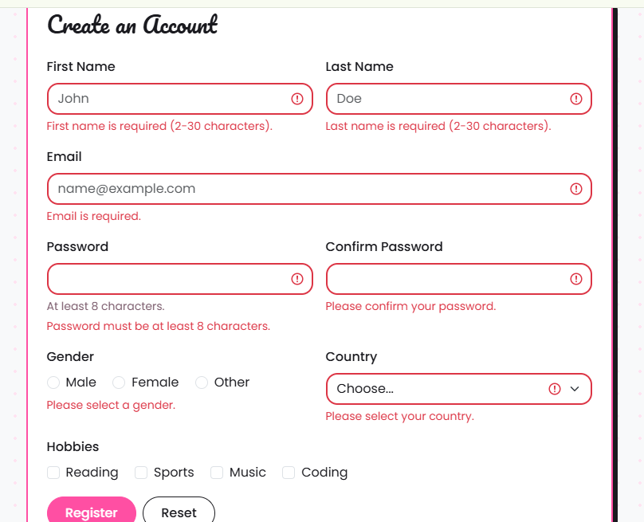
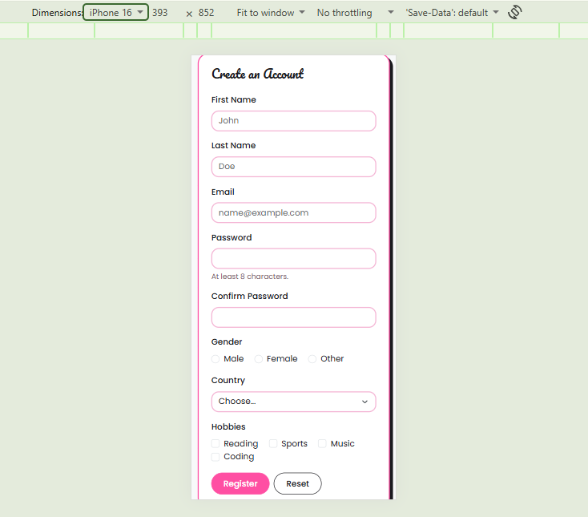

Assignment 4. Forms and Validation

Name: Zainab
Group: 2501

In this assignment I made forms with HTML and Bootstrap and added validation to them. Open index.html to see the main page with links to all tasks.

Files:
- index.html - main page with links to all tasks
- task0-contact.html - Task 0
- task1-html5-validation.html - Task 1
- task2-bootstrap-form.html - Task 2
- task3-bootstrap-validation.html - Task 3
- task4-registration.html - Task 4
- theme.css - my pink and black colors for all pages
- screenshots/ - all screenshots

 Part 1. Basic HTML Forms

 Task 0. Simple Contact Form

Make a basic contact form with Name, Email, Message and a Submit button. Every field must have a label.

I made the form with a text input for the name, an email input, a textarea for the message and a Send button. Each input has a <label> connected with for and id, so when you click the label the input gets focus.

 Task 1. Form with HTML5 Validation

Add built-in validation attributes and test how the browser checks them.

I added required to all fields, minlength and maxlength to the name and message, and the email input has type="email". When I click Send with empty fields the browser shows a message and does not send the form. When I write a wrong email like abc the browser says the email is not correct.

Empty form:

Wrong email:

 Part 2. Bootstrap Forms

 Task 2. Bootstrap Form Styling

Make the contact form again with Bootstrap classes, use the grid, and add placeholders and helper text.

I connected Bootstrap by CDN. I used container, row and col-md-6 so the Name and Email are in one line on big screens. I used form-label and form-control for the fields, added placeholders, and a helper text under the email ("We'll never share your email with anyone else.") with form-text.

 Task 3. Bootstrap Validation Styles

Use is-valid and is-invalid classes and show feedback messages under the inputs.

I added novalidate to the form so the browser's own messages are turned off. Under each input there are two divs: valid-feedback ("Looks good!") and invalid-feedback (for example "Email is required."). With JavaScript I check each field with checkValidity() and add the class is-valid or is-invalid. The fields are also checked when I leave them. I tested it with empty fields and wrong data, and then with correct data.

Invalid data (red):

Valid data (green):

 Part 3. Advanced Form Project

 Task 4. Registration Form

Make a registration form with first name, last name, email, password and confirm password, gender (radio), hobbies (checkbox), country (select), and Submit and Reset buttons. It should be responsive and have HTML5 and Bootstrap validation.

What I did:
- Used the Bootstrap grid (col-md-6 and col-12), so on a phone the fields go one under another.
- Gender is radio buttons with the same name, so only one can be chosen. Hobbies are checkboxes, so more than one can be chosen.
- Country is a select. The first option "Choose..." is disabled and empty, so the user must choose a real country.
- HTML5 validation: required, minlength="8" for the password, type="email" for the email.
- Bootstrap validation: green and red borders with messages under the fields.
- Confirm password is checked with JavaScript. If it is not the same as the password it shows "Passwords do not match." Gender is also checked with JavaScript because radio buttons do not show the red border.
- The Reset button clears the form and removes all the green and red styles.

Desktop view:

Errors after clicking Register with an empty form:

Mobile view:

Summary of my work process

I started with the simple forms in Task 0 and Task 1 to learn how labels and the HTML5 attributes like required, minlength and type="email" work. Then I made the same form with Bootstrap and learned the grid system and the form classes. In Task 3 I learned how is-valid and is-invalid work together with checkValidity() in JavaScript, and why we use novalidate. The hardest part was Task 4: checking that the two passwords are the same and checking the radio buttons, because they need extra JavaScript. At the end I made a pink and black theme in `theme.css` and tested all the forms with correct and wrong data, and checked the mobile view. I used Claude as a helper while building the project and for explaining the code to me.
